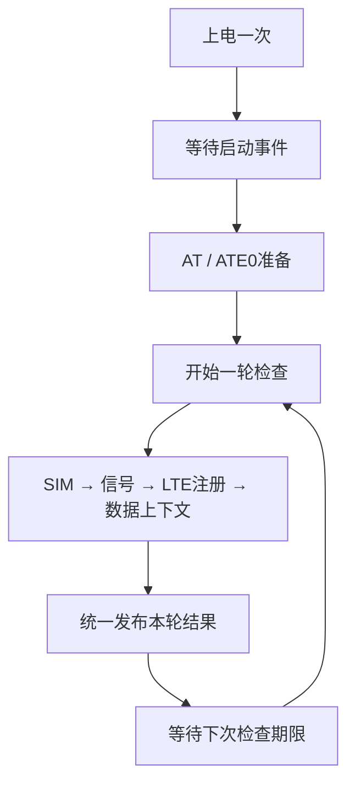
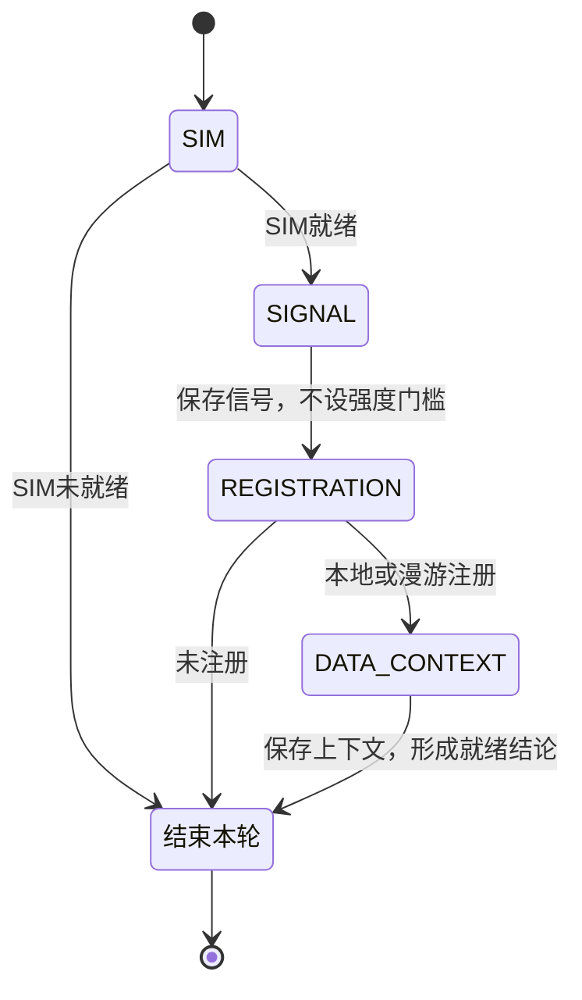

# 4G驻网与数据就绪检测

本版只回答：**最近一次检测是否满足尝试TCP建连的本地条件？** 服务持续检查并发布结果，不配置APN、不激活上下文、不建立TCP，也不执行TTS；AT核心故障时按已确认策略尝试一次上下电恢复。
旧最小服务已删除；本版重新使用相同源码路径，[旧文档](15_4G最小服务与调用流程.md)中的流程、测试命令和资源数据不代表本版。

## 先看主流程，再读细节

从[service_worker](../../services/network/gt02_network_service.c)读起，再看`check_network()`的四状态局部检测流程；启动和恢复分别在`start_modem()`、`recover_modem()`。装配和默认时间在[gt02_app.c](../../app/gt02_app.c)，对外契约在[服务头文件](../../services/network/gt02_network_service.h)。



服务线程顺序执行流程，提交异步操作后在统一队列上等待匹配完成事件；等待会挂起本线程，AT接收线程继续运行，锁存的AT故障仍能唤醒它。
没有覆盖整个服务的七阶段状态机、查询索引或长期保存的调度时间。主流程由调用栈表达，本轮检测由局部`state`推进，`monitor`仅保存最近查询类型和跨轮恢复额度。启动期限、检测间隔及本轮结果各自保存在使用它们的局部变量中，没有为普通查询另设服务超时。

| 函数 | 独立职责 |
|---|---|
| `service_worker()` | 启动→检测→发布→间隔；流程错误进入独立恢复过程 |
| `start_modem()` / `prepare_modem()` | 上电→等待RDY→必要时rearm→AT/ATE0；准备隔离或超时按间隔重试 |
| `check_network()` | switch按SIM、信号、注册、数据上下文列出动作及转移；条件不足提前结束，统一合成本轮结论 |
| `query_status()` / `wait_completion()` | 提交并等待匹配完成，区分流程错误与查询结果错误，不重复计时 |
| `receive_event()` / `wait_until()` | 等待事件或时刻，优先检查锁存故障和队列溢出 |
| `publish_status()` / `publish_fault()` | 一次提交整轮快照，或撤销就绪并发布故障 |
| `recover_modem()` | 保持故障等待；仅AT故障且有额度时切电、清旧事件、重新启动 |

短小字段赋值和IP门槛直接保留在所属函数中。回调`on_modem_event()`只按值投递事件，不在AT线程执行业务或等待下一条命令。
首次阅读的状态、资源和修改位置索引见[4G代码阅读与重构说明](../设计文档/4G代码阅读与重构说明.md)。

## 四项检查各回答什么

检查顺序直接写在`check_network()`的局部状态机中，同一时刻只有一项查询在途。当前查询类型即`state`，循环顶部统一请求并等待结果；switch分支只保存本步数据、判断结束条件和设置下一状态，不使用索引递增推测下一项。



任一状态的查询ERROR、超时或未接受的-EAGAIN统一结束本轮并清空载荷；流程故障返回给服务主线程处理。`state`仅存在于本次调用，不恢复成覆盖启动、恢复和周期调度的统一状态机。

| 查询 | 厂家实现 | 服务判断 |
|---|---|---|
| SIM | `AT+CPIN?` | 必须为READY；需要PIN/PUK或尚未就绪时提前发布未就绪 |
| 信号 | `AT+CSQ` | 记录RSSI，0及99（未知）不阻止后续检查 |
| LTE注册 | `AT+CEREG?` | 当前状态1或5表示通过；搜索中等正常结果稍后复查 |
| 数据上下文 | `AT+QIACT?` | 选择CID 1，要求已激活且IPv4满足基本可用条件 |

信号强弱或未知不是硬门槛；**信号查询本身失败时，本轮仍保守报告未就绪**，不把查询失败当成已获得可信状态。
当前厂家注册解析只接受所实现的两字段格式和状态范围；若模组返回其他格式，应扩展厂家解析并验证，不能让服务直接解析字符串。

数据上下文结果由[统一接口](../../interfaces/gt02_modem.h)中的`gt02_modem_data_context`描述：`active`和4字节`ipv4`。QIACT查询复用现有命令ID；APN配置、激活等命令仍为预留。
厂家先完成目标行及IPv4语法校验，再交付结果：没有目标CID或只有OK是正常inactive；重复目标、坏格式、越界地址和尾随垃圾报错；目标为IPv6时返回不支持。

服务要求IPv4首字节不为0、不为127且小于224；`0.0.0.0`、回环、组播/保留地址不能放行。没有子网掩码时不臆测子网广播地址。
这些条件不保证DNS、路由、服务器或实际TCP操作成功。

## 公开结论与本轮临时数据分开

业务使用`gt02_network_service_start(config)`启动一次，`gt02_network_service_get_status(out)`读取独立快照；另有供装配使用的非阻塞AT故障事件入口。start返回0只表示已启动。

| 公开状态 | 含义 |
|---|---|
| STOPPED | 尚未启动 |
| STARTING | 上电、等待RDY或准备AT |
| NOT_READY | 条件不满足、查询失败，或上次成功结果已过期 |
| DATA_READY | 本轮SIM、LTE注册和目标IPv4数据上下文均通过，可尝试建连 |
| FAULT | 通道或流程故障，停止普通提交；AT故障可进行一次受控恢复 |

每步先校验输入并写入私有临时结果。必要检查完成或已明确条件不满足时，才统一发布本轮结论；不会把新SIM结果和旧IP拼成一次成功检测。
正常未就绪的快照`error=0`，结合`query`及有效数据判断原因。普通查询错误发布NOT_READY和负错误码，并清空本轮载荷；下次间隔到达后重新检查。
只有结果对应的字段才有效：例如SIM未就绪提前结束时，注册和数据上下文尚未查询，不能解释为已确认掉网。

刷新开始不会立即撤销仍有效的上一轮成功结论。getter检查`checked_at_ms`：成功结果过期时返回NOT_READY/-ESTALE，旧字段仅作诊断，不再允许放行。
`checked_at_ms`是开机毫秒时间，不能当日历时间。轮询反映最近观测，不是即时掉网通知。

## 启动和失败边界

装配先完成硬件init与AT初始化；服务start绑定厂家回调后才执行上电。RDY可能在`power_on()`返回前到达，事件会保留在队列中，不在上电结束后清除。
厂家每次RDY均转换为STARTUP_READY，服务仅在等待启动时接收，其他阶段忽略重复通知。服务收到启动事件后才请求prepare；未收到则超时进入FAULT，不发送AT探测。

周期查询的AT超时发布NOT_READY/-ETIMEDOUT，并按间隔重查，不再直接结束服务。
AT层正在隔离旧回复时，提交返回-EAGAIN；本次未入队，服务发布NOT_READY并继续间隔尝试。收到旧结束行并排空输入后AT恢复调度，后续检查可继续。
一直没有结束行时，独立隔离预算到期转AT故障，不把短暂静默当成恢复依据。
AT故障通知由服务独立锁存，即使队列已满也不丢失；服务先撤销放行，再执行一次断电、上电、等待新RDY、session_rearm及重新握手。
恢复流程失败保持FAULT；完整四项查询成功后，才重新分配处理后续独立故障的恢复机会。正常ERROR和单次命令超时不直接重启。
启动/恢复超时、事件队列溢出或流程错误停止普通推进，但保留事件处理，等待可能随后到达的AT故障通知。
准备/查询操作没有服务层的第二套超时：`prepare/query`返回0后，下层须通过一次完成事件交付成功、失败或超时。服务不会提前把正常但较慢的操作误判为故障。
`operation_timeout_ms`已从配置删除，应用及测试的配置需同步去掉该字段；这是一项行为修复，不属于仅调整代码排版。
详细边界与前置条件见[AT超时隔离与会话恢复](17_AT超时隔离与会话恢复.md)。

| 默认配置 | 毫秒 | 用途 |
|---|---:|---|
| `startup_timeout_ms` | 10000 | power_on返回后等待RDY及必要会话恢复的总上限 |
| `retry_interval_ms` | 5000 | 未就绪或可继续查询错误后的复查间隔 |
| `check_interval_ms` | 30000 | 已就绪时下一轮检查间隔 |
| `result_valid_ms` | 45000 | 成功结果有效期，必须大于已就绪检查间隔 |

以上是首版策略值，需实板验证，不是模组规格承诺。当前应用默认服务开启，旧AT查询和硬件上下电测试均关闭；控制入口互斥。

| 时间归属 | 使用位置 | 用途 |
|---|---|---|
| 局部`startup_deadline_ms` | `start_modem()` | power_on返回后，RDY及必要rearm的共同截止时刻 |
| 传入`wait_until()`的绝对时刻 | 服务周期或准备重试 | 下次检测/准备尝试到达时间，返回后不再保存 |
| 无操作计时 | `wait_completion(..., 0, ...)` | 等待准备/查询完成，由下层交付超时；AT故障仍可唤醒 |
| 无结束时刻 | `recover_modem()`中的`wait_until(0)` | 停止普通推进，等后续AT故障；迟到普通结果不能恢复查询 |

等待准备或查询时没有其他阶段留下的时刻可误用。快照有效期独立由getter检查，慢查询期间旧成功结论过期仍撤销放行。

当前线程负责这一条检测流程，等待操作时不会执行尚未实现的TCP/TTS业务。后续这些功能应分别管理生命周期和事件归属，不能直接把任意业务事件塞进当前队列：无在途操作的间隔及rearm等待会忽略旧通知。

## 日志与验证入口

服务每次发布结论打印快照。示意日志中的state=3为DATA_READY，state=2为NOT_READY，state=4为FAULT；query=3表示数据上下文，SIM=2表示READY。

```text
gt02_lierda: RDY URC received; registration/TCP not tested
gt02_network: 4G startup ready: prepare AT channel
gt02_lierda: Data context CID=1: active=1, IPv4=10.1.2.3; TCP not tested
gt02_network: 4G status: state=3 error=0 query=3 SIM=2 RSSI=99 reg=1 context=1 IP=10.1.2.3
```

未激活上下文时会报告context=0和NOT_READY，并按5秒间隔复查；不会主动执行QIACT激活。

[周期服务QEMU测试](../../tests/modem_at/src/network.c)通过真实服务、AT核心和Lierda解析器替换电源/UART。模式为`CONFIG_AT_TEST_NETWORK`，不复用已删除的旧SERVICE测试模式。
在NCS工具链终端使用工程外目录构建：

```powershell
west build --no-sysbuild -b qemu_cortex_m3 -d ../_verification/MyProject/modem_network tests/modem_at -- -DCONFIG_AT_TEST_NETWORK=y -DCONFIG_AT_TEST_NETWORK_CASE=0
west build -d ../_verification/MyProject/modem_network -t run
```

场景0..7依次覆盖注册失效再恢复、未激活再恢复、无IP再恢复、查询ERROR后恢复、缺失/迟到RDY、重复早到RDY、真实AT超时及旧结束行后重查恢复、慢查询/快照过期后仍能完成。
场景8/9检查错误事件类型/查询归属；10检查慢准备不被旧启动时刻误判；11检查等待完成事件期间AT故障仍能唤醒服务。
场景12..16分别检查prepare未接受的-EAGAIN重试、已接受prepare超时重试、普通事件队列溢出、prepare ERROR停止推进、SIM未就绪提前结束并复查。新增场景先在结构调整前的服务上运行通过，再对新结构回归。
用例还检查刷新中保留上一轮快照、错误轮次不交付半成品、FAULT不被迟到事件复活、超时隔离期间不发新命令，以及RSSI 0/99不设门槛。
[厂家操作表测试](../../tests/modem_at/src/capability.c)另行覆盖数据上下文的多行、目标选择、边界格式、ERROR和超时。
本轮不自动烧录；仿真和构建都不能替代实板功能、长期稳定性及实际TCP操作验证。

## 验证记录（2026-11-04）

- 默认GT02主构建通过：Flash 69,096 B、RAM 26,896 B。
- NETWORK 8组QEMU场景全部通过；真实AT厂家操作表用例通过，覆盖16类上下文正文、嵌入NUL及10秒无回复超时等边界。
- 旧信息查询模式单独构建通过：Flash 68,116 B、RAM 27,296 B；产物位于工程外`../_verification/MyProject/legacy_information_cleanup`，未覆盖默认主构建。
- 未自动烧录，未创建Git提交；实板、长期网络状态维护及实际TCP操作仍需验证。

## 超时调度验证（2026-11-05）

- 默认主构建通过：Flash 69,440 B、RAM 26,896 B；未自动烧录或提交Git。
- AT核心5组配置通过，覆盖明确ERROR/CME/CMS后继续、取消队列单次通知、隔离期间URC、迟到结束行后恢复及传输/超长输入故障。超时用例还覆盖read期间跨过截止时间但返回旧OK的边界。
- 厂家操作表用例通过，超时后-EAGAIN、旧CMS结束行解除隔离及再次查询均正常。
- NETWORK 6/0/7通过：查询超时先NOT_READY，隔离期不发送，旧结束行后恢复；原周期掉网恢复和服务保护超时行为保持正确。
- 原信息查询测试的超时场景通过；旧验证入口仍可自行决定结束本次信息查询，不强制跟随服务重查。
- 一直没有旧结束行时不能自动恢复正常发送；启动准备失败及真实通道故障仍按既有服务策略处理。

## 服务操作计时归属修复（2026-11-06）

- 删除服务配置`operation_timeout_ms`；准备/查询等待下层唯一完成事件，不再启用服务操作保护计时。下层接受操作后必须交付完成事件；若实现违反此契约而永不回调，服务会继续等待，不能把删除重复计时理解为能自动修复失联回调。
- `next_action_ms`仅用于检测及准备重试调度，`startup_deadline_ms`仅用于RDY/会话恢复期限；快照过期检查保持独立。等待操作结果时，锁存的AT故障仍可唤醒服务并进入原恢复流程。
- 默认主构建通过：Flash 71,012 B、RAM 26,960 B。31组QEMU配置全部通过：AT核心5组、网络服务12组、恢复10组、厂家能力1组、信息查询3组。
- 新增/更新场景验证慢查询超过旧保护预算后仍能完成、慢准备不误用旧启动期限、等待结果时AT故障仍能唤醒、会话恢复持续未就绪时按期失败。恢复期限用例还核对故障快照更新时间，避免将初次AT故障误认为恢复超时已经发生。
- 用户的代码可理解性要求已整合至[gt02-readable-c技能](../../.agents/skills/gt02-readable-c/SKILL.md)，并由[项目编程约定](../../AGENTS.md)要求每次编程应用；技能格式校验通过。
- 未自动烧录或提交Git。上述结果不替代实板上下电、网络时序、长期运行及TCP功能验收。

## 顺序流程结构调整（2026-11-06）

- 以本次改动前的工作区服务源码为基准，副本及旧QEMU日志保存在工程外`../_verification/MyProject/service_sequence_baseline`；没有回退此前AT、厂家及计时修复的工作区改动。
- `service_worker()`顺序组织启动、检查、发布、间隔及故障恢复；删除七个内部阶段、步骤索引、长期保存的调度/启动时刻和恢复启动标志。`monitor`只保留当前查询类型及恢复额度，启动期限成为局部变量。
- 外部API、查询顺序、错误/超时分类、早到及重复RDY、旧事件清理、一次恢复策略、快照规则、线程栈和优先级保留。结果范围检查也保留，本次没有借重排放宽后端契约。
- 新增五个边界配置12..16，先在旧服务上运行通过，再对顺序实现运行。新实现共36组QEMU配置全部通过：网络17、恢复10、AT核心5、厂家能力1、信息查询3。
- 默认主工程构建通过：Flash 70,880 B、RAM 26,960 B；相对调整前减少132 B Flash，RAM不变。线程定义及三个公开函数的实现与本次基准逐字比较一致；头文件仅补充等待上下文说明。
- 这是一条检测线程的顺序组织方式；等待操作时AT继续接收、故障能唤醒，但并未实现同一线程上的TCP/TTS事件调度。后续不同生命周期需要各自拥有进度和明确的事件归属。
- 中文说明与本地链接、差异格式检查通过。没有增加线程、动态内存或生产测试钩子，没有烧录或创建Git提交；模拟测试不替代实板时序与长期运行验证。

## 单轮检测局部状态机（2026-11-06）

- 按用户反馈，将`check_network()`改为局部四状态switch；统一请求/等待及错误收尾，各分支集中表达本步结果、提前结束条件和下一状态。启动、间隔及恢复仍由服务线程顺序组织。
- 仅调整该函数及用途注释，查询顺序、错误结果、输出提交、恢复额度重置及公开接口保持；状态不跨检测轮次保存，没有新增阶段表或辅助函数。
- 主工程构建通过：Flash 70,800 B、RAM 26,960 B。相关27组QEMU配置全部通过（网络17组、恢复10组），未烧录或提交Git。
