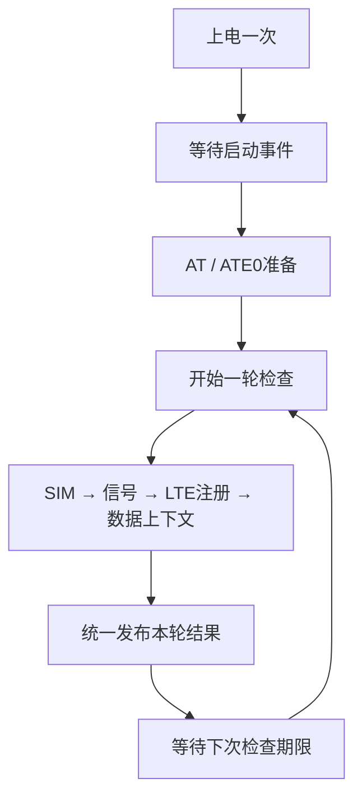

# 4G驻网与数据就绪检测

本版只回答：**最近一次检测是否满足尝试TCP建连的本地条件？** 服务上电一次，持续检查并发布结果，不配置APN、不激活上下文、不建立TCP，也不执行TTS或自动上下电恢复。
旧最小服务已删除；本版重新使用相同源码路径，[旧文档](15_4G最小服务与调用流程.md)中的流程、测试命令和资源数据不代表本版。

## 先看主流程，再读细节

从[service_worker](../../services/network/gt02_network_service.c)读起，再看同文件的检查清单和辅助函数。装配和默认时间在[gt02_app.c](../../app/gt02_app.c)，对外契约在[服务头文件](../../services/network/gt02_network_service.h)。



事件循环只等待队列事件或最近期限；某项查询提交后立即返回循环，不同步等待这条AT完成。
内部只保存阶段、步骤索引、期限和本轮临时结果，没有把每种公开状态扩展成一套事件调度框架。

| 函数 | 独立职责 |
|---|---|
| `service_worker()` | 呈现一次启动、事件接收、期限处理和故障退出 |
| `handle_modem_event()` | 识别启动/准备/查询完成事件，选择应推进的流程 |
| `begin_check()` / `submit_query()` | 初始化本轮私有结果，先登记在途上下文再提交查询 |
| `advance_check()` | 校验当前结果，保存合法数据，决定下一项或提前结束 |
| `finish_check()` / `publish_status()` | 合成本轮结论、一次提交快照，并安排下轮时间 |
| `handle_deadline()` | 空闲到期开始下轮；在途到期停止提交 |

短小字段赋值和IP门槛直接保留在所属函数中。回调`on_modem_event()`只按值投递事件，不在AT线程执行业务或等待下一条命令。

## 四项检查各回答什么

检查顺序集中在`check_plan[]`，同一时刻只有一项查询在途。

| 查询 | 厂家实现 | 服务判断 |
|---|---|---|
| SIM | `AT+CPIN?` | 必须为READY；需要PIN/PUK或尚未就绪时提前发布未就绪 |
| 信号 | `AT+CSQ` | 记录RSSI，0及99（未知）不阻止后续检查 |
| LTE注册 | `AT+CEREG?` | 当前状态1或5表示通过；搜索中等正常结果稍后复查 |
| 数据上下文 | `AT+QIACT?` | 选择CID 1，要求已激活且IPv4满足基本可用条件 |

信号强弱或未知不是硬门槛；**信号查询本身失败时，本轮仍保守报告未就绪**，不把查询失败当成已获得可信状态。
当前厂家注册解析只接受所实现的两字段格式和状态范围；若模组返回其他格式，应扩展厂家解析并验证，不能让服务直接解析字符串。

数据上下文结果由[统一接口](../../interfaces/gt02_modem.h)中的`gt02_modem_data_context`描述：`active`和4字节`ipv4`。QIACT查询复用现有命令ID；APN配置、激活等命令仍为预留。
厂家先完成目标行及IPv4语法校验，再交付结果：没有目标CID或只有OK是正常inactive；重复目标、坏格式、越界地址和尾随垃圾报错；目标为IPv6时返回不支持。

服务要求IPv4首字节不为0、不为127且小于224；`0.0.0.0`、回环、组播/保留地址不能放行。没有子网掩码时不臆测子网广播地址。
这些条件不保证DNS、路由、服务器或实际TCP操作成功。

## 公开结论与本轮临时数据分开

业务使用`gt02_network_service_start(config)`启动一次，`gt02_network_service_get_status(out)`读取独立快照；另有供装配使用的非阻塞AT故障事件入口。start返回0只表示已启动。

| 公开状态 | 含义 |
|---|---|
| STOPPED | 尚未启动 |
| STARTING | 上电、等待RDY或准备AT |
| NOT_READY | 条件不满足、查询失败，或上次成功结果已过期 |
| DATA_READY | 本轮SIM、LTE注册和目标IPv4数据上下文均通过，可尝试建连 |
| FAULT | 通道或流程故障，停止普通提交；AT故障可进行一次受控恢复 |

每步先校验输入并写入私有临时结果。必要检查完成或已明确条件不满足时，才统一发布本轮结论；不会把新SIM结果和旧IP拼成一次成功检测。
正常未就绪的快照`error=0`，结合`query`及有效数据判断原因。普通查询错误发布NOT_READY和负错误码，并清空本轮载荷；下次间隔到达后重新检查。
只有结果对应的字段才有效：例如SIM未就绪提前结束时，注册和数据上下文尚未查询，不能解释为已确认掉网。

刷新开始不会立即撤销仍有效的上一轮成功结论。getter检查`checked_at_ms`：成功结果过期时返回NOT_READY/-ESTALE，旧字段仅作诊断，不再允许放行。
`checked_at_ms`是开机毫秒时间，不能当日历时间。轮询反映最近观测，不是即时掉网通知。

## 启动和失败边界

装配先完成硬件init与AT初始化；服务start绑定厂家回调后才执行上电。RDY可能在`power_on()`返回前到达，事件会保留在队列中，不在上电结束后清除。
厂家每次RDY均转换为STARTUP_READY，服务仅在等待启动时接收，其他阶段忽略重复通知。服务收到启动事件后才请求prepare；未收到则超时进入FAULT，不发送AT探测。

周期查询的AT超时发布NOT_READY/-ETIMEDOUT，并按间隔重查，不再直接结束服务。
AT层正在隔离旧回复时，提交返回-EAGAIN；本次未入队，服务发布NOT_READY并继续间隔尝试。收到旧结束行并排空输入后AT恢复调度，后续检查可继续。
一直没有结束行时，独立隔离预算到期转AT故障，不把短暂静默当成恢复依据。
AT故障通知由服务独立锁存，即使队列已满也不丢失；服务先撤销放行，再执行一次断电、上电、等待新RDY、session_rearm及重新握手。
恢复流程失败保持FAULT；完整四项查询成功后，才重新分配处理后续独立故障的恢复机会。正常ERROR和单次命令超时不直接重启。
服务保护超时、事件队列溢出或流程错误停止普通推进，但保留事件处理，等待可能随后到达的AT故障通知。
详细边界与前置条件见[AT超时隔离与会话恢复](17_AT超时隔离与会话恢复.md)。

| 默认配置 | 毫秒 | 用途 |
|---|---:|---|
| `startup_timeout_ms` | 10000 | power_on返回后的启动事件等待上限 |
| `operation_timeout_ms` | 20000 | 覆盖最长10秒命令、5秒隔离及调度余量 |
| `retry_interval_ms` | 5000 | 未就绪或可继续查询错误后的复查间隔 |
| `check_interval_ms` | 30000 | 已就绪时下一轮检查间隔 |
| `result_valid_ms` | 45000 | 成功结果有效期，必须大于已就绪检查间隔 |

以上是首版策略值，需实板验证，不是模组规格承诺。当前应用默认服务开启，旧AT查询和硬件上下电测试均关闭；控制入口互斥。

## 日志与验证入口

服务每次发布结论打印快照。示意日志中的state=3为DATA_READY，state=2为NOT_READY，state=4为FAULT；query=3表示数据上下文，SIM=2表示READY。

```text
gt02_lierda: RDY URC received; registration/TCP not tested
gt02_network: 4G startup ready: prepare AT channel
gt02_lierda: Data context CID=1: active=1, IPv4=10.1.2.3; TCP not tested
gt02_network: 4G status: state=3 error=0 query=3 SIM=2 RSSI=99 reg=1 context=1 IP=10.1.2.3
```

未激活上下文时会报告context=0和NOT_READY，并按5秒间隔复查；不会主动执行QIACT激活。

[周期服务QEMU测试](../../tests/modem_at/src/network.c)通过真实服务、AT核心和Lierda解析器替换电源/UART。模式为`CONFIG_AT_TEST_NETWORK`，不复用已删除的旧SERVICE测试模式。
在NCS工具链终端使用工程外目录构建：

```powershell
west build --no-sysbuild -b qemu_cortex_m3 -d ../_verification/MyProject/modem_network tests/modem_at -- -DCONFIG_AT_TEST_NETWORK=y -DCONFIG_AT_TEST_NETWORK_CASE=0
west build -d ../_verification/MyProject/modem_network -t run
```

场景0..7依次覆盖注册失效再恢复、未激活再恢复、无IP再恢复、查询ERROR后恢复、缺失/迟到RDY、重复早到RDY、真实AT超时及旧结束行后重查恢复、结果过期及服务保护期限。
用例还检查刷新中保留上一轮快照、错误轮次不交付半成品、FAULT不被迟到事件复活、超时隔离期间不发新命令，以及RSSI 0/99不设门槛。
[厂家操作表测试](../../tests/modem_at/src/capability.c)另行覆盖数据上下文的多行、目标选择、边界格式、ERROR和超时。
本轮不自动烧录；仿真和构建都不能替代实板功能、长期稳定性及实际TCP操作验证。

## 验证记录（2026-11-04）

- 默认GT02主构建通过：Flash 69,096 B、RAM 26,896 B。
- NETWORK 8组QEMU场景全部通过；真实AT厂家操作表用例通过，覆盖16类上下文正文、嵌入NUL及10秒无回复超时等边界。
- 旧信息查询模式单独构建通过：Flash 68,116 B、RAM 27,296 B；产物位于工程外`../_verification/MyProject/legacy_information_cleanup`，未覆盖默认主构建。
- 未自动烧录，未创建Git提交；实板、长期网络状态维护及实际TCP操作仍需验证。

## 超时调度验证（2026-11-05）

- 默认主构建通过：Flash 69,440 B、RAM 26,896 B；未自动烧录或提交Git。
- AT核心5组配置通过，覆盖明确ERROR/CME/CMS后继续、取消队列单次通知、隔离期间URC、迟到结束行后恢复及传输/超长输入故障。超时用例还覆盖read期间跨过截止时间但返回旧OK的边界。
- 厂家操作表用例通过，超时后-EAGAIN、旧CMS结束行解除隔离及再次查询均正常。
- NETWORK 6/0/7通过：查询超时先NOT_READY，隔离期不发送，旧结束行后恢复；原周期掉网恢复和服务保护超时行为保持正确。
- 原信息查询测试的超时场景通过；旧验证入口仍可自行决定结束本次信息查询，不强制跟随服务重查。
- 一直没有旧结束行时不能自动恢复正常发送；启动准备失败及真实通道故障仍按既有服务策略处理。
