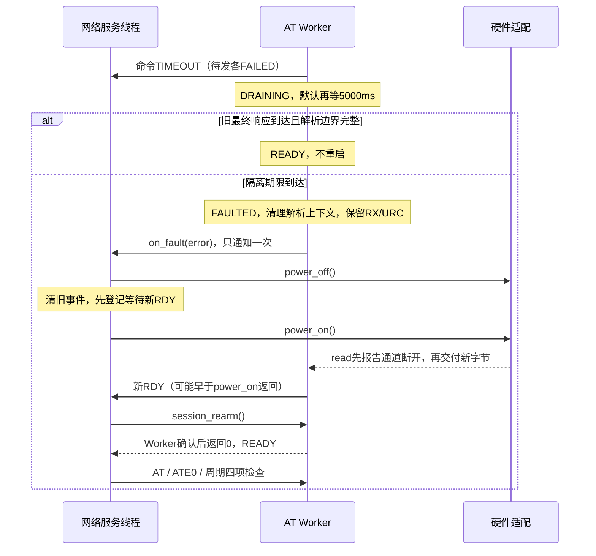

# AT超时隔离与会话恢复

本次保留单AT Worker、4个待发位置、共享正文缓存、静态内存及原有命令表。只补齐异常路径，不实现TCP、TTS或APN。

## 先看一次恢复



## 状态和接口

| 状态 | 普通提交 | 接收处理 | 退出条件 |
|---|---|---|---|
| READY | FIFO接受 | 正文、最终响应、URC | 超时转DRAINING；传输/完整性故障转FAULTED |
| DRAINING | -EAGAIN | 旧最终响应只用于隔离，URC正常分发 | 旧最终响应且当前批次处理完、无残行则READY；隔离到期则FAULTED |
| FAULTED | -EPIPE | 保留日志及已注册URC，不再交付旧事务 | 外部确认新会话后，Worker接受rearm才READY |

`gt02_at_config.drain_timeout_ms`为独立隔离时间，0使用5000ms。
`on_fault(error, context)`在请求全部收尾和解析清理后由AT线程调用，不得阻塞；与命令SUCCESS/FAILED/TIMEOUT三态分开。

`gt02_at_session_rearm()`由外部线程调用，同步等待Worker确认，不等待模组启动。未初始化返回-EACCES，非FAULTED返回-EBUSY，缺少断开后新接收证据或仍有残行返回-EAGAIN，ISR返回-EWOULDBLOCK，AT线程调用返回-EDEADLK。
所有配置表与回调上下文长期有效；回调中只能做短小解析和非阻塞事件投递。

## 清理和旧数据隔离

`fail_core()`先关闭提交，再通知当前及待发请求，各一次。超时保持旧行解析以等待最终响应；真正进入FAULTED才调用`clear_context()`统一重建。
`clear_rx_context()`释放SDK的`parser_data.rx_buf`链，清除残行、丢弃标志、匹配缓存及输入指针；`clear_context()`进一步清除事务正文长度、终止标志和期限。
这些操作只在Worker离开SDK解析函数后执行，不在SDK的URC回调中释放其正在使用的缓存。

`read()`报告-EPIPE时清除旧残行，但不把断开视为新会话成立；没有当前事务时，旧OK/ERROR不会完成任何请求，FAULTED内也不会解除保护。
发送不再依赖RX空闲：当前批次已处理、没有事务和残行时即可从FIFO发送。异步业务结果仍走URC表；例如OK结束建连命令，之后的+CIPOPEN不延长AT事务。

硬件原来每次read取新的generation基线，若消费者跨过整个上下电窗口，就可能漏报边界。现在用rx_lock保护持久read_generation；在任何新字节交付前，先对尚未报告的周期变化返回-EPIPE。仍保留五个接口、原锁与原上下电时序，AT不访问硬件generation。

## 服务策略与调用者责任

装配层把on_fault转交服务的`gt02_network_service_notify_at_fault(error)`，向配置注入session_rearm函数指针；服务不引用具体AT实现或修改解析变量。
故障原因独立锁存，队列满不丢失；服务优先处理故障，停止放行TCP。恢复使用原服务线程，不创建恢复线程。

同一恢复周期只尝试一次电源重启，任何恢复步骤失败都保持FAULT，不重复切电。完整四项状态查询成功后，才重新获得一次恢复机会；无SIM或未注册仍按原周期检测，正常ERROR不会直接重启。
准备事务超时也允许隔离和重试；服务保护到期会停止普通推进，线程仍等待后续AT故障通知，不提前退出。

恢复入口的必要条件是故障后的通道断开、新接收及完整解析边界；**这些本地检查不能证明物理模组已停止旧命令**。调用者必须先可靠终止旧会话，并确认新会话成立。本工程使用断电接口成功、新上电成功与新RDY作为证据，不声称测量了供电电压。
替换其他read实现时，必须保证通道变化持久保留并在新字节之前交付-EPIPE；不能依赖读取者恰好在断开时运行。

## 验证入口

[恢复测试](../../tests/modem_at/src/recovery.c)链接真实AT核心、SDK解析器、厂家及服务；只替换字节I/O和电源，不驱动实板。

```powershell
west build --no-sysbuild -b qemu_cortex_m3 -d ../_verification/MyProject/modem_recovery tests/modem_at -- -DCONFIG_AT_TEST_RECOVERY=y -DCONFIG_AT_TEST_RECOVERY_CASE=0
west build -d ../_verification/MyProject/modem_recovery -t run
```

场景0为核心隔离、旧半行、新RDY、恢复拒绝（包括ISR/AT回调）、回调一次及连续URC；1为整条链路恢复成功，并验证完整检查后可恢复后续独立故障；2..6分别为断电失败、缺失新RDY、准备ERROR、上电失败、恢复后再次故障且不重复重启；7为rearm失败；8为故障通知时队列满。
原AT故障5组、周期服务8组及厂家能力测试继续作为回归。硬件读接口的持久边界由实现审查及模拟契约验证，真实UART/PM、供电和长期运行仍须实板验收。

## 验证记录（2026-11-05）

- 默认GT02/nRF52840主工程构建通过：Flash 71,128 B、RAM 26,960 B；相对此前69,440 B/26,896 B，分别增加1,688 B/64 B。
- QEMU共24组配置运行通过：新增恢复9组，原AT故障5组、周期服务8组、厂家能力1组、信息查询超时1组。
- 新用例覆盖故障通知一次、取消回调一次、断开本身不能恢复、旧半行与新RDY隔离、恢复入口的ISR/Worker拒绝、连续URC发送、早到/重复RDY，以及恢复失败与次数限制。
- 满队列通知及恢复机会重置均通过：完整四项检查后可处理下一次独立故障，未恢复完整检查时再次故障不反复重启。
- 中文文档本地链接及差异格式检查通过；无新增线程、动态内存、SDK修改、自动烧录或Git提交。
- 未连接实物硬件；真实UART接收周期切换、PM挂起/恢复、供电是否可靠终止旧会话及长期稳定性仍需实板确认。
