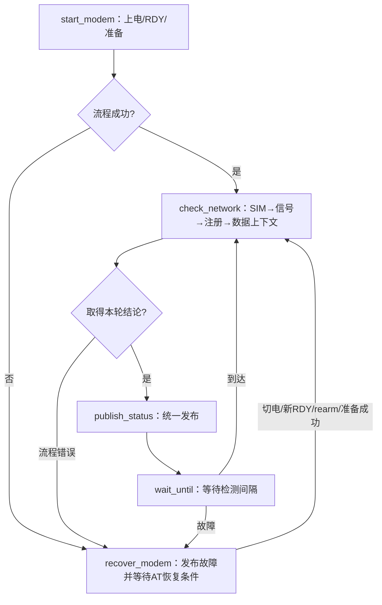

# 4G代码阅读与重构说明

本说明用于定位当前代码。早期整理仅改变内部表达；2026-11-06另行修复服务重复超时，并按用户确认的方向将服务调整为线程顺序执行。当前没有七阶段服务状态机或查询索引；AT命令预算、隔离机制、一次恢复策略与硬件接口保留，未引入通用状态机框架、线程或动态内存。

## 先从这两个问题开始

| 模块 | 为什么存在 | 输入与输出 | 管理的资源 |
|---|---|---|---|
| [AT事务层](../../adapters/modem/gt02_modem_at.c) | 把多方提交串行化，避免正文、URC、迟到结束行混淆 | 输入命令、字节、期限及恢复请求；输出事务回调、URC及故障通知 | 4项FIFO、1个在途事务、共享正文、SDK接收缓存、隔离与恢复状态 |
| [网络服务](../../services/network/gt02_network_service.c) | 判断何时允许尝试TCP，并决定何时恢复模组 | 输入厂家结果/启动事件、AT故障及启动/调度时刻；输出能力请求和状态快照 | 事件队列、局部整轮结果、最近查询类型、一次恢复机会 |

服务通过能力表调用厂家和电源接口，厂家提交AT事务，AT通过read/write获取字节并回调厂家；不要按“服务→AT→厂家→硬件”理解调用链。

## AT层：按状态理解一轮工作

先读文件开头的`core_state`及资源定义，再读`at_worker()`与`advance_transaction()`。

| 当前状态/条件 | 输入 | 动作与后续状态 |
|---|---|---|
| READY，无在途事务且解析边界完整 | FIFO有请求 | 出队、登记在途事务、发送；保持READY |
| READY，有在途事务 | 正文或URC | 正文进入共享缓存；URC独立回调 |
| READY，有在途事务 | 最终OK/ERROR | SDK内登记结果，SDK返回后完成回调一次，再调度 |
| READY，有在途事务 | 命令期限到达 | `begin_isolation()`：当前TIMEOUT，待发FAILED，转DRAINING |
| DRAINING | 旧最终响应且批次/残行处理完 | 恢复READY，不再次完成旧请求 |
| DRAINING | 独立隔离期限到达 | `enter_fault()`：清理并通知，转FAULTED |
| 运行阶段 | 传输/解析完整性错误 | `enter_fault()`；重复故障只清接收残留，不重复通知 |
| FAULTED | 注册URC | 继续接收和分发，不发送普通请求 |
| FAULTED | 外部rearm请求 | Worker检查断开后接收证据及解析边界；通过才READY |

`tx`集中保存同一次在途事务的数据；`rx`集中保存拼行和SDK缓存。两者由Worker拥有，不能通过外部线程直接清理。
会话观测用一个三值枚举代替两个布尔值：未见断开→已断开→已收到随后数据。它只表达本地观测，不代替调用方确认旧会话可靠终止。

理解三个动作即可区分结束方式：`finish_current()`完成单条；`begin_isolation()`因超时暂时隔离；`enter_fault()`因流失效或隔离失败封闭调度。共同的请求收尾在`cancel_requests()`，没有布尔参数切换两种不同生命周期。

内部传参只保留真实输入：`start_request()`使用已经出队的`tx.request`，`receive_input()`内部保留实际长度并登记错误，`advance_transaction()`读取已登记结果，三者不再传递重复参数。
`rx.read_succeeded_once`表示read曾返回0，区分首次成功读取前的未就绪与后续断开；它覆盖整个Worker生命周期，不能随残行清理、故障或rearm而清零。它不是当前通道可用或模组RDY的标志。
厂家层已去除只写不读的`ready_seen`及信号缓存，CSQ结果直接通过事件交给服务维护快照。每次RDY仍经回调上报，去重继续由服务阶段负责；SDK回调签名保留必要参数。

Worker仍先处理本轮期限/已登记错误和恢复请求，再接收解析，最后按状态推进。read可能跨过截止时间，因此交付接收批次前仍再次检查期限；这不是可以随意删除的重复。

## 网络服务：先读线程主流程，再读一次检测

`service_worker()`直接表达启动、检测、发布、间隔和出错后恢复。`check_network()`采用SIM、信号、注册、数据上下文四状态的局部switch；统一请求及等待在循环顶部，每个分支直接表达动作和下一状态，读者不需要换算索引或追踪多个状态处理函数。

准备及查询仍是下层异步操作，服务线程在`wait_completion()`中等完成事件，AT线程独立运行。它不是CPU忙等，也不承诺同一服务线程等待期间还能处理未来TCP/TTS业务。

| 需要跨调用保留的内容 | 当前表达 |
|---|---|
| 启动、准备与检测的主流程 | 调用栈及直接代码，不再保存长期phase/step |
| 本轮四项检测的局部进度 | `check_network()`中的`state`，值为当前公共查询类型，每轮从SIM开始 |
| 当前查询类型 | `monitor.query`，用于完成事件匹配及故障快照 |
| 恢复次数限制 | `monitor.recovery_used`，跨检测轮次保留 |
| 启动/rearm期限 | `start_modem()`的局部绝对时刻，power_on返回后起算 |
| 检测/准备重试间隔 | 传入`wait_until()`的局部绝对时刻 |
| 普通prepare/query超时 | 下层完成事件，服务不重复计时 |

`query_status()`的返回值只表示流程是否完整；`event.error`表达已接受查询的成功/失败/超时。查询ERROR、超时或未接受的-EAGAIN结束本轮并按间隔复查，事件归属错误及-EPIPE停止普通推进。prepare只有未接受的-EAGAIN及完成事件中的超时会重试，其他失败保持故障。

`receive_event()`集中维护AT故障优先于队列溢出和普通结果的规则；故障在`recover_modem()`中才消费。`recover_modem()`没有恢复条件时继续等待，迟到普通结果不能复活查询。
重复RDY在非启动完成等待中忽略；启动/rearm的共同期限不重新开始，旧服务事件只在切电成功后清理。

## 修改功能时找哪里

| 需求 | 修改位置 |
|---|---|
| 正文、回显、最终响应与URC的归属 | AT的`on_line()` |
| FIFO接受/拒绝、参数化文本校验 | AT的`enqueue_request()` |
| 超时隔离及故障收尾 | AT的`begin_isolation()`、`enter_fault()`及Worker期限检查 |
| 会话恢复条件与同步确认 | AT的`handle_rearm()`、`gt02_at_session_rearm()` |
| 检查哪些状态、按什么顺序 | 服务的`check_network()` |
| 提交请求及识别完成结果 | 服务的`query_status()`、`prepare_modem()`、`wait_completion()` |
| 等待、到期和故障优先级 | 服务的`receive_event()`、`wait_until()` |
| 是否重启、恢复机会何时重置 | 服务的`recover_modem()`、`check_network()` |

## 行为保留与后续单独评估

早期可读性重构保留回调顺序/上下文、锁范围、期限起算位置、错误码、重复RDY过滤和旧回复隔离。删除服务重复操作超时属于后续单独的功能修复；本次顺序结构调整继续保留这些契约。错误完成类型/查询类型仍报错，停止后的普通迟到事件不复活流程。已有结果范围检查也保留，未以精简为名放宽后端契约。

以下两处不借重构改变策略：

- AT在一轮开始时先检查命令超时，再处理已登记的发送/解析错误；两者同时成立时的优先级留待单独评估。
- rearm、间隔及故障停止时仍会忽略没有在途操作的旧事件。当前队列只接收检测相关结果；扩展TCP/TTS前必须先按生命周期明确事件归属，不能直接复用忽略全部旧通知的等待路径。

测试通过只提供回归证据，不证明任意时序等价，也不替代实板的UART/电源及长期验证。

## 验证记录（2026-11-05）

- 以重构前`d04cdf8`为行为基线；公共头文件、硬件/厂家源码、线程栈与优先级、生产配置未修改。
- 主工程构建通过：Flash 71,032 B、RAM 26,960 B；相对重构前Flash减少96 B，RAM不变。
- QEMU 26组配置运行通过：原24组回归，加两个错误事件归属场景。新增两组也用隔离目录内的原AT/服务源码运行通过，未临时替换工作区源码。
- 对照26组日志，关键事务、状态及故障处理顺序一致；连续URC压力场景中不确定数量的RDY接收日志不参与序列比较，URC是否正确交付仍由测试断言检查。
- 自动化验证未增加生产测试钩子；没有烧录、提交Git或修改SDK。潜在策略问题保留在上一节，未混入重构。

## 内部参数收敛记录（2026-11-06）

- `start_request()`、`receive_input()`、`advance_transaction()`改为无参数；实际字节长度只在接收函数内部使用，读错误仍在本轮推进时统一收尾。
- 首次读取成功历史归入`rx.read_succeeded_once`，不随残行、故障或rearm清零。恢复用例增加“rearm后尚未再次成功读取便断开”的断言，确认仍能进入故障。
- 厂家只写不读的启动标记和信号缓存已删除；回调、URC及服务结果的交付规则保留。
- 主工程构建及26组QEMU回归通过；Flash 71,000 B，RAM 26,960 B。相对此前可读性重构版Flash再减少32 B，RAM不变。
- 本次未烧录或提交Git；仿真不替代实板及长期运行验收。

## 服务顺序结构验证（2026-11-06）

- 基准为本次调整前的工作区服务，保存于工程外`../_verification/MyProject/service_sequence_baseline`，不是回退到历史Git提交。
- 七个阶段及查询索引移除，流程由线程调用栈表达。公开API、线程定义和原错误/恢复契约保持；已有结果范围检查未删除。
- 五个新增边界场景先在旧实现通过，再对新结构回归；36组QEMU配置全部通过。默认主工程Flash 70,880 B、RAM 26,960 B，相对本次基准减少132 B Flash。
- 常规网络及恢复场景的状态日志抽样比较，合并连续相同结论后状态序列前缀一致；这只是辅助回归证据，不证明所有并发时序严格等价。
- 当前没有TCP/TTS调度；顺序等待挂起服务线程，AT线程继续运行且故障可唤醒。实际硬件、供电及长期运行仍需验收，未烧录或提交Git。
